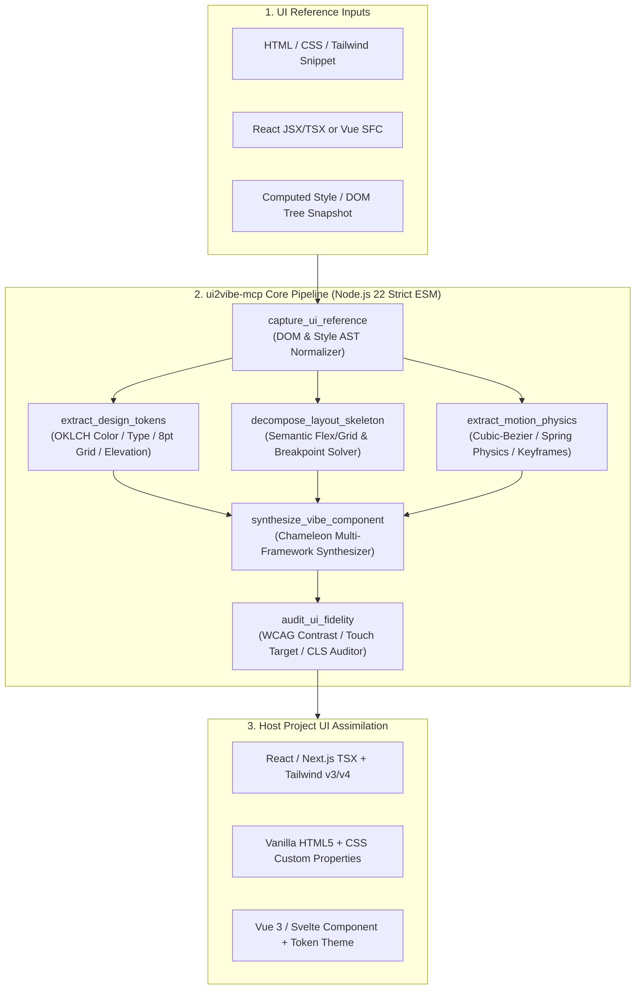

# `@kr-pro-labs/ui2vibe-mcp`

> **UI Design Token, Responsive Layout Skeleton, Motion Physics & Interactive Component Absorption MCP Server for Vibe Coding**
>
> **[English](README.md)** | **[한국어 (Korean)](README.ko.md)**

[](https://github.com/KR-PRO-Labs/ui2vibe-mcp/actions/workflows/ci.yml)
[](LICENSE)
[](https://nodejs.org/)
[](https://modelcontextprotocol.io/)

**`ui2vibe-mcp`** is a flagship Model Context Protocol (MCP) server developed by **[KR-PRO-Labs](https://github.com/KR-PRO-Labs)** (`@sjdhfjdj30-hash`). While [`clonevibe-mcp`](https://github.com/KR-PRO-Labs/clonevibe-mcp) extracts and transplants backend/core algorithms from reference codebases, **`ui2vibe-mcp`** is its frontend counterpart: it absorbs any UI reference (HTML/CSS/Tailwind snippets, React JSX/TSX, Vue SFCs, or computed DOM snapshots) and distills it into:

1. **Perceptual Design Tokens**: sRGB/Hex/HSL to **OKLCH** conversion, automatic Dark/Light mode token pairing, modular typography scales, 8pt grid spacing quantization, multi-layered box shadows, and glassmorphism blur tokens.
2. **Semantic Responsive Layout Skeletons**: Prunes redundant wrapper `div` chains ("div-soup") into semantic HTML5 landmarks (`header`, `nav`, `main`, `section`, `article`, `aside`, `footer`) and solves Flexbox/CSS Grid axes and responsive breakpoints (`sm`, `md`, `lg`, `xl`).
3. **Motion Physics Equations**: Parses CSS `transition`, `@keyframes`, `cubic-bezier(x1, y1, x2, y2)`, and Tailwind transition utilities, solving equivalent physical harmonic oscillator spring parameters (`stiffness`, `damping`, `mass`, `settlingTimeMs`) with zero external animation library dependencies.
4. **Chameleon Multi-Framework Synthesis**: Emits production-ready, zero-dependency components for `react-tailwind`, `react-css-vars`, `vanilla-css`, `vue-tailwind`, or `svelte-css` complete with `:root`/`.dark` CSS Custom Properties and `tailwind.config` theme extensions.
5. **Automated WCAG & Fidelity Auditing**: Verifies WCAG 2.1 AA (`>= 4.5:1`) and AAA (`>= 7.0:1`) contrast ratios, minimum `44x44px` interactive touch targets, `@media (prefers-reduced-motion: reduce)` accessibility guardrails, and CLS layout stability.

---

## Architecture Pipeline



---

## MCP Tools & Resources

### 6 Core Tools
| Tool Name | Description |
| :--- | :--- |
| `capture_ui_reference` | Parses HTML/JSX/Vue markup, inline styles, CSS rulesets, and Tailwind utilities into a normalized `UiReferenceSnapshot` with pseudo-state hooks (`:hover`, `:focus-visible`, `:active`, dark mode). |
| `extract_design_tokens` | Converts colors into perceptual OKLCH space, synthesizes dark-mode counterparts, classifies semantic roles (`background`, `surface`, `text-primary`, `accent`, `border`, `glass`), and quantizes 8pt grid spacing & typography scales. |
| `decompose_layout_skeleton` | Collapses redundant single-child wrapper `div` chains into semantic HTML5 containers and extracts Flex/Grid layout axes and responsive breakpoint rules. |
| `extract_motion_physics` | Extracts CSS transitions, `@keyframes`, and `cubic-bezier` curves, solving second-order spring physics parameters (`stiffness`, `damping`, `mass`, `settlingTimeMs`). |
| `synthesize_vibe_component` | Generates a self-contained, zero-dependency UI component for `react-tailwind`, `react-css-vars`, `vanilla-css`, `vue-tailwind`, or `svelte-css` along with `:root`/`.dark` CSS Custom Properties. |
| `audit_ui_fidelity` | Audits WCAG 2.1 contrast ratios, 44x44px touch targets, `prefers-reduced-motion` guardrails, CLS stability, and computes an overall UI fidelity score (`0–100`). |

### 2 Built-in MCP Resources
- `ui2vibe://presets/motion-curves` — Reference catalog of physical spring & cubic-bezier presets (snappy micro-interaction, fluid sheet transition, elastic bounce, decelerated enter).
- `ui2vibe://guide/ui-absorption-workflow` — Step-by-step playbook for absorbing reference UI designs into host projects without external UI bloat.

---

## Quick Start

```bash
git clone https://github.com/KR-PRO-Labs/ui2vibe-mcp.git
cd ui2vibe-mcp
npm install
npm run typecheck
npm test
npm run build
```

### MCP Client Configuration

```json
{
  "mcpServers": {
    "ui2vibe": {
      "command": "node",
      "args": ["/path/to/ui2vibe-mcp/dist/index.js"]
    }
  }
}
```

---

## License
MIT © [KR-PRO-Labs](https://github.com/KR-PRO-Labs) & [@sjdhfjdj30-hash](https://github.com/sjdhfjdj30-hash)
