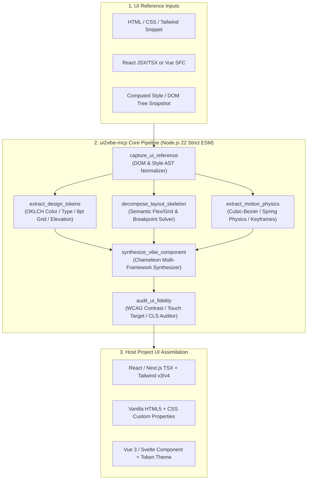

# Architecture Map — `@kr-pro-labs/ui2vibe-mcp`

## System Topology

## O(1) File & Symbol Index

| Module Path | Key Exports | Responsibility |
| :--- | :--- | :--- |
| `src/types/ui-domain.ts` | `TargetUiFramework`, `ColorToken`, `DesignTokenSet`, `LayoutSkeleton`, `ContainerQueryCondition`, `MotionSpec`, `ScrollTimelineSpec`, `SvgMorphSpec`, `SynthesizedComponent`, `UiFidelityReport` | Canonical domain schemas & types for the 6-stage UI absorption pipeline. |
| `src/capture/ui-reference-capturer.ts` | `captureUiReference`, `parseStyleDeclarations` | Normalizes raw HTML/JSX/Vue/CSS/Tailwind input into a structured DOM tree, style map, container queries (`@container`), subgrid classes, SVG path snapshots, and pseudo-state hooks (`:hover`, `:focus-visible`, `:active`, dark mode). |
| `src/tokens/design-token-extractor.ts` | `extractDesignTokens`, `hexToOklch`, `oklchToHex`, `computeRelativeLuminance`, `computeContrastRatio`, `quantizeTo8ptGrid` | Perceptual sRGB -> Linear RGB -> OKLab -> OKLCH conversion, automatic dark-mode token pairing, 8pt spacing grid quantization, typography scale & elevation extraction. |
| `src/layout/layout-skeleton-decomposer.ts` | `decomposeLayoutSkeleton` | Prunes redundant single-child wrapper `div` chains ("div-soup") into semantic HTML5 tags (`header`, `nav`, `main`, `section`, `article`, `aside`, `footer`), extracts Flex/Grid axes & breakpoints, and resolves container query boundaries & CSS Subgrids. |
| `src/motion/motion-physics-extractor.ts` | `extractMotionPhysics`, `solveSpringFromCubicBezier`, `buildSvgMorphSpec`, `parseAndNormalizeSvgPath`, `interpolateNormalizedCommands`, `PRESET_MOTION_CURVES` | Parses CSS transitions, `@keyframes`, and Tailwind utilities; solves harmonic oscillator spring parameters (`stiffness`, `damping`, `mass`, `settlingTimeMs`) from `cubic-bezier` curves; extracts scroll-driven timelines (`animation-timeline: view()`); normalizes SVG path morphing. |
| `src/synthesizer/vibe-component-synthesizer.ts` | `synthesizeVibeComponent`, `detectHostUiFramework` | Synthesizes zero-dependency components across `react-tailwind`, `react-css-vars`, `vanilla-css`, `vue-tailwind`, and `svelte-css` with container queries, subgrid, scroll timeline progressive fallbacks, `:root`/`.dark` CSS custom properties, and `prefers-reduced-motion` guardrails. |
| `src/audit/ui-fidelity-auditor.ts` | `auditUiFidelity` | Evaluates WCAG 2.1 AA/AAA contrast ratios, minimum 44x44px interactive touch targets, reduced-motion accessibility fallbacks, `@supports` scroll-timeline fallbacks, CLS layout stability, and overall fidelity score (`0–100`). |
| `src/server.ts` | `createUi2VibeServer` | Registers 6 MCP tools and 2 MCP resources using `@modelcontextprotocol/sdk`. |
| `src/index.ts` | `main` | CLI stdio entrypoint (`ui2vibe-mcp`) plus full programmatic module exports. |
| `tests/ui2vibe.test.ts` | Vitest suite | End-to-end and unit verification across all 6 stages, container queries, subgrid, scroll timelines, SVG morphing, and MCP server tool/resource handlers. |
